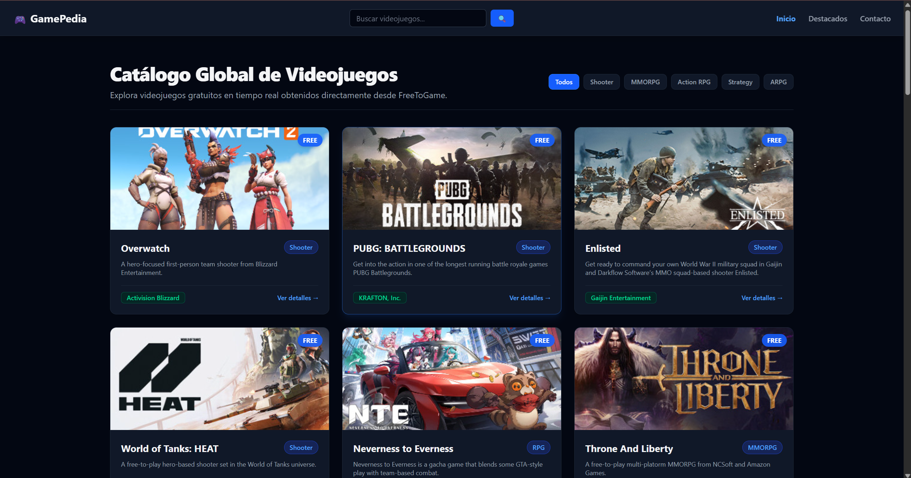
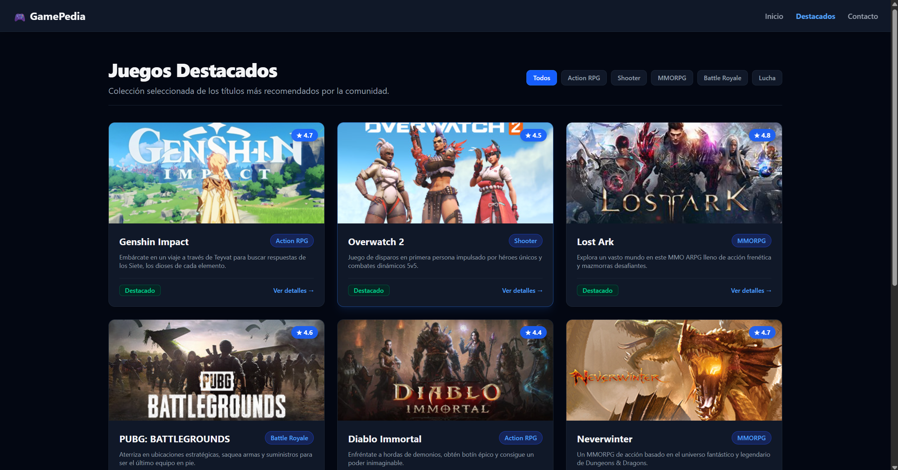
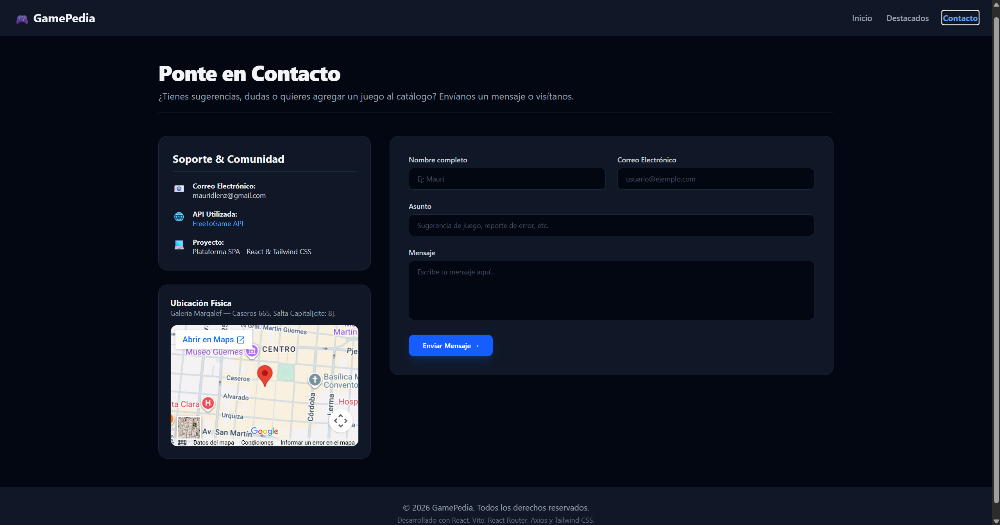
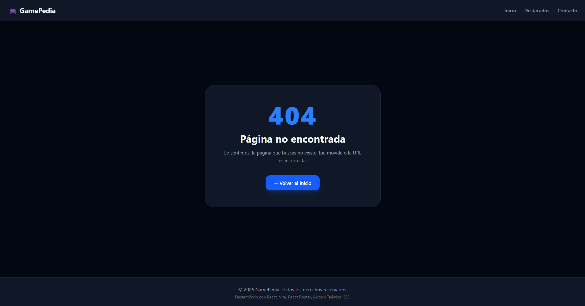

# 🎮 GamePedia — Plataforma SPA de Videojuegos

GamePedia es una Single Page Application (SPA) interactiva desarrollada con **React**, **Vite** y **Tailwind CSS**. La plataforma permite explorar un catálogo actualizado de juegos, realizar búsquedas dinámicas, filtrar contenido y enviar consultas a través de un formulario de contacto totalmente integrado.

---

## 📸 Vista Previa del Proyecto

<div align="center">

### 🏠 Página Principal (Home)


---

### ⭐ Juegos Destacados (Local)


---

### 📩 Formulario de Contacto & Ubicación


---

### 🚫 Página de Error 404


</div>

---

## 🚀 Características Principales

* **Catálogo de Juegos de API**: Consumo de datos dinámicos en tiempo real desde la API pública de *FreeToGame*.
* **Juegos Destacados / Locales**: Sección con catálogo precargado desde una base de datos local (*hardcoded*) para garantizar disponibilidad inmediata y rendimiento optimizado.
* **Modales Interactivos**: Detalle ampliado de videojuegos mediante componentes modales responsivos para una experiencia de usuario rápida sin recargar la página.
* **Búsqueda y Filtros**: Filtro dinámico con opción de limpieza rápida en los campos de búsqueda.
* **Sección de Contacto Integrada**: Formulario optimizado con control de estados (*envío, éxito, reintento*) utilizando `@formspree/react`.
* **Manejo de Rutas no Encontradas (Página 404)**: Vista personalizada y amigable para capturar URLs inexistentes o errores de navegación, permitiendo al usuario retornar a la página principal con un solo clic.
* **Diseño Responsive**: Interfaz adaptable a dispositivos móviles, tablets y computadoras de escritorio creada con **Tailwind CSS**.
* **Ubicación Interactiva**: Panel lateral con mapa embebido de Google Maps (*Galería Margalef - Salta Capital*).

---

## 🛠️ Tecnologías Utilizadas

* **Frontend**: React.js, Vite
* **Estilos**: Tailwind CSS
* **Peticiones HTTP / Servicios**: Axios, `@formspree/react`
* **Control de Versiones**: Git & GitHub

---

## 🔧 Instalación y Ejecución Local

Para ejecutar este proyecto en tu entorno local, sigue estos pasos:

1. **Clonar el repositorio:**
```bash
git clone https://github.com/AstraLord007/game-pedia.git
cd game-pedia
```

2. **Instalar dependencias:**
```bash
npm install
```

3. **Iniciar el servidor de desarrollo:**
```bash
npm run dev
```

4. Abre el enlace local proporcionado en la terminal (por ejemplo, http://localhost:5173) en tu navegador.

---

## 📂 Estructura del Proyecto

```text
src/
├── assets/          # Recursos estáticos e imágenes para la documentación
├── components/      # Componentes reutilizables (Navbar, Footer, Cards, Modales, etc.)
├── data/            # Datos locales de respaldo / configuración (juegos destacados)
├── pages/           # Vistas principales de la SPA (Home, LocalGames, Contact, NotFound, etc.)
├── App.jsx          # Componente principal y estructura de rutas
└── main.jsx         # Punto de entrada de la aplicación
```